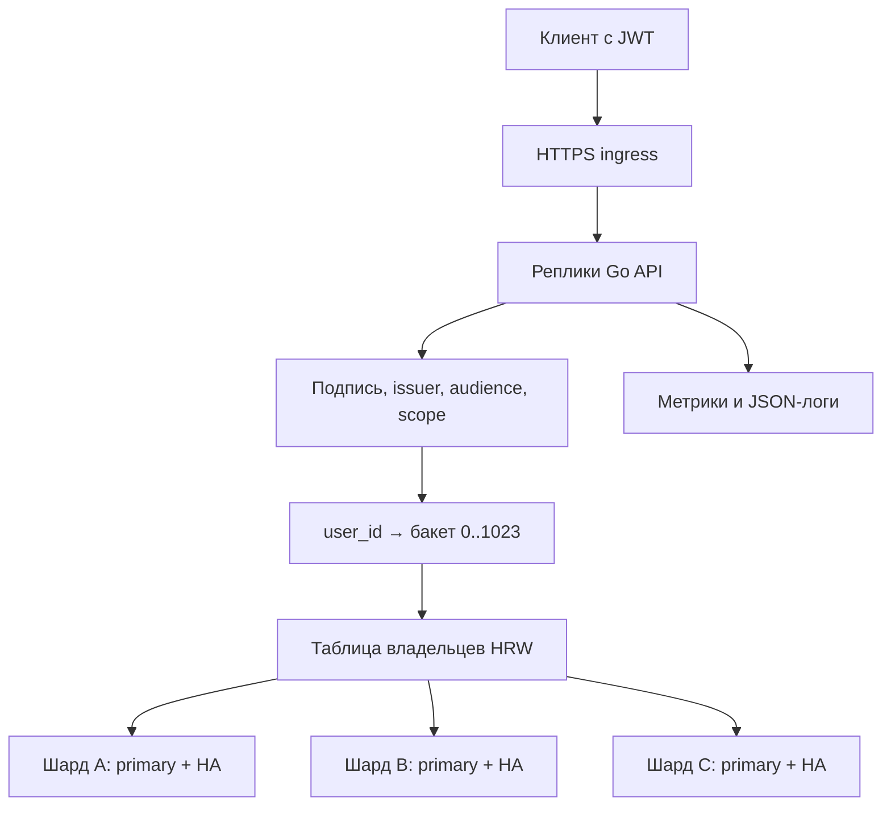

# Архитектура и масштабирование

## Что значит «миллионы пользователей»

Предположим, есть 1 000 000 пользователей, у каждого в среднем 10 подписок. Это 10 000 000 строк, но частота обращений может быть очень разной. Если каждый открывает приложение раз в день, средняя частота посещений около 11,6 в секунду. Если 100 000 человек делают запрос каждую секунду, это уже 100 000 RPS. Второй случай требует совершенно других ресурсов.

Архитектура устраняет очевидные препятствия росту: нет списка всех пользователей в одном ответе, нет глобального SUM на каждый пользовательский запрос, нет выбора шарда через центральный сетевой сервис. Но ни код, ни микробенчмарк не доказывают конкретный production RPS.

## Путь запроса

В локальном Compose A и B — одиночные PostgreSQL. Подпись `primary + HA` обозначает production-требование к каждому логическому шарду; репликация БД не создаётся самим Go-приложением. Её должен предоставлять managed PostgreSQL или проверенная система управления PostgreSQL-кластером.

## Почему выбран user_id

Все записи пользователя размещаются на одном шарде. Создание, изменение, удаление, список, стоимость и ключи идемпотентности обслуживаются одной базой и одной транзакцией. Поэтому нет распределённой транзакции между двумя PostgreSQL на обычном запросе.

Поле пользователя нельзя изменить через PATCH. Внешняя система идентификации отвечает за существование пользователя; отдельная таблица с паролями и процессом входа здесь отсутствует.

Очень большой или очень активный пользователь всё равно сосредоточен на одном шарде. HRW балансирует количество ключей/бакетов статистически, а не CPU, число байтов или интенсивность операций. Для «горячих» арендаторов могут потребоваться отдельное размещение, квоты и другая схема ключа. Это не исправляется случайным переключением пользователя на другую БД.

## Два уровня распределения

Первый уровень:

`bucket = первые 32 бита SHA-256(домен алгоритма || 16 байт UUID) & 1023`.

Здесь 1024 — фиксированное количество бакетов, степень двойки. Бакет — логическая группа строк, а не отдельная PostgreSQL-таблица и не экземпляр БД. Строки имеют колонку bucket_id, поэтому группу можно целиком найти и перенести.

Второй уровень — rendezvous, другое название HRW (highest random weight):

1. Для бакета вычисляется SHA-256 от домена алгоритма, четырёхбайтового номера бакета и стабильного ID каждого шарда.
2. Выбирается шард с максимальным 256-битным значением.
3. При равенстве выигрывает первый ID в отсортированном списке; порядок исходного JSON не влияет на результат.
4. Результаты всех бакетов сохраняются в массив owners при старте.

На запросе не требуется перебирать шарды: SHA-256 пользователя → индекс бакета → owners[bucket]. Это O(1) по числу шардов. Построение таблицы при запуске — O(B × S), где B — число бакетов, S — число шардов; память — O(B).

## Что даёт добавление шарда

При добавлении D бакет либо остаётся на прежнем победителе, либо D получает наибольший score. Переноса между прежними A, B и C быть не может: их оценки не изменились.

При удалении B перемещаются только его бакеты. Остальные победители остаются прежними. Это свойство проверяется тестами.

Для конфигураций из архива переход с двух шардов на три перемещает 338 из 1024 бакетов — около 33%. План находится в `rebalance-plan-example.json`. Проценты пользователей и байтов будут отличаться: бакеты могут иметь разный объём.

Не путай это с `hash(user) % число_шардов`: изменение числа шардов у такого выражения часто перемещает значительно больше ключей. Здесь `%`/битовая маска используются только для неизменного числа бакетов, а физический владелец выбирается HRW.

## Чего хэширование не делает

Хэширование не копирует данные, не создаёт резервную копию и не делает репликацию. Если просто добавить шард в конфиг, часть пользователей начнёт искать свои строки в пустой базе. Поэтому автоматического переключения на «следующий доступный шард» нет. Ошибка владельца даёт 503, а восстановление/переключение primary выполняется внутри того же логического shard_id.

ID шарда — постоянная часть размещения. Переименование `shard-a` в `database-1` эквивалентно удалению одного узла и добавлению другого. Изменение hostname для HA failover при сохранении данных и shard_id — другой вид операции.

Количество бакетов и версия алгоритма после загрузки данных фиксируются. Команда plan откажется менять buckets. Увеличение их количества требует отдельной миграции алгоритма, которой в этой версии нет.

## Защита от разных конфигураций у реплик API

Fingerprint — SHA-256 от версии алгоритма, epoch, количества бакетов и отсортированных ID шардов. Пароли и адреса подключений в него не входят. Каждый шард хранит fingerprint и свой ID в routing_guard.

В начале каждой транзакции вызывается check_routing. Если ID, fingerprint или frozen не соответствуют запросу, транзакция не читает и не меняет пользовательские таблицы. Проверка выполняется в БД, а не только при старте процесса. Поэтому старый процесс после переключения топологии не сможет продолжить писать по прежней карте.

API может стартовать и оставаться ready, если есть хотя бы один доступный шард с правильной топологией. Неправильная конфигурация всей карты не совпадёт ни с одним корректным guard. Частичная недоступность отражается отдельной метрикой каждого шарда; пользователи здоровых шардов продолжают работать.

## Где находятся границы согласованности

- Одна CRUD-операция пользователя атомарна в одной PostgreSQL-транзакции.
- Ответ POST и запись его idempotency response фиксируются одним COMMIT.
- PATCH/DELETE требуют версию записи и не применяют устаревшее изменение.
- Страницы списка не являются единым многозапросным снимком: между страницами данные могут измениться.
- Стоимость использует текущую сохранённую цену на весь заданный период. История смены тарифа не сохраняется.
- Общая аналитика по всем шардам должна выполняться отдельным ETL/CDC/аналитическим процессом. В обычном пользовательском API нет scatter-gather по миллионам пользователей.

## Соединения и рост реплик

Каждый API-процесс имеет отдельный pgxpool на шард. pool_max=20 — максимум соединений **на процесс на шард**, а не на весь кластер.

Если HPA разрешает 10 API-подов и rolling update временно добавляет один, на одной БД потенциально будет `(10 + 1) × 20 = 220` runtime-соединений. Добавь запас для миграций, диагностики и управления. Нельзя оставить default max_connections=100 и ожидать, что такое развёртывание выдержит верхнюю границу.

Можно уменьшить пул или поставить совместимо настроенный PgBouncer. Административные операции с session advisory locks должны идти напрямую в PostgreSQL либо через session pooling. Применение transaction pooling требует отдельной проверки настроек prepared statements и pgx; в базовом варианте используется прямое подключение.

Ограничение 128 одновременных HTTP-запросов и 2000 RPS задано на одну реплику. После масштабирования общий предел растёт. Это защита от части перегрузок, а не распределённый лимит на каждого пользователя. Внешний gateway должен реализовать квоты и защиту от злоупотреблений по требованиям продукта.
